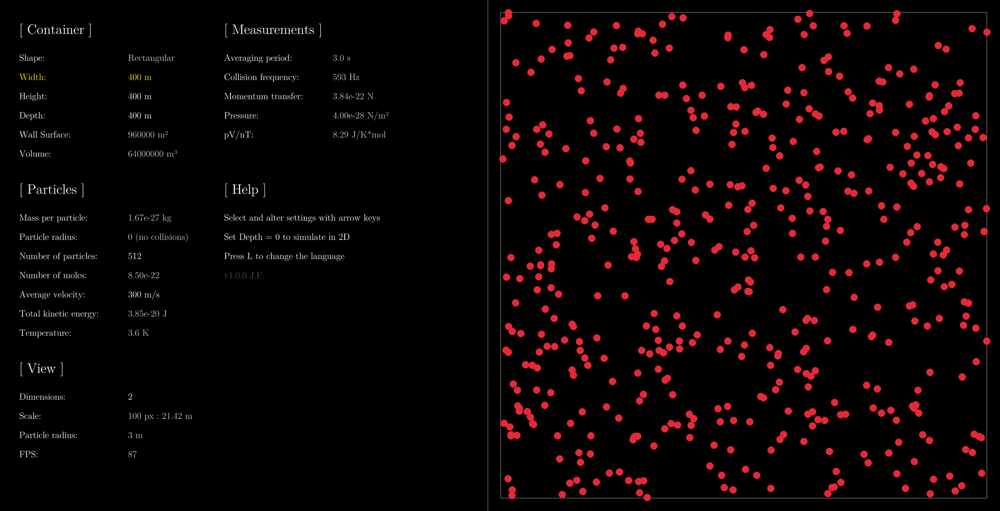

gas
===

Ideal gas simulation

Capabilities
------------
- Resizing rectangular/cuboidal particle container
- Adding and removing particles
- Setting particle speed
- Viewing in 2D and 3D
- Measures and calculates derived properties of the system (e.g. pressure)
- Approximates universal gas constant (R) empirically
- Supports Polish language

Running
-------
Either compile it yourself with CMake or enjoy the web version at https://gas.jfras.org/! Note that as of now, keyboard is the only supported input device.
